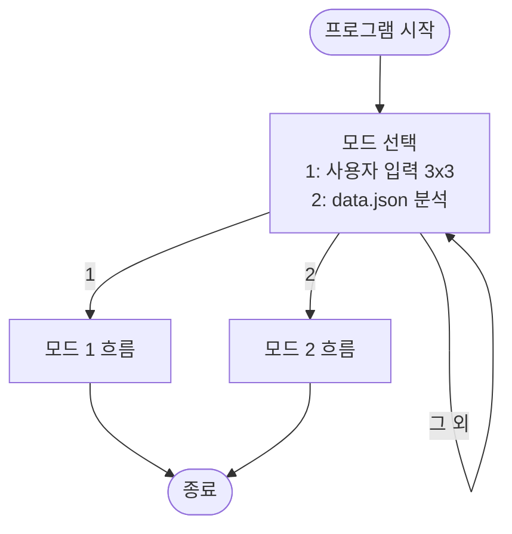
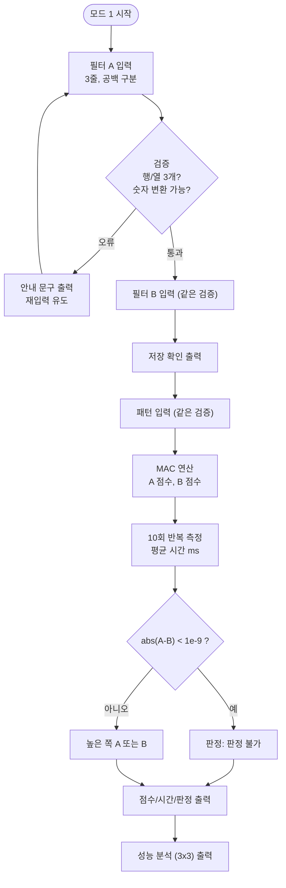
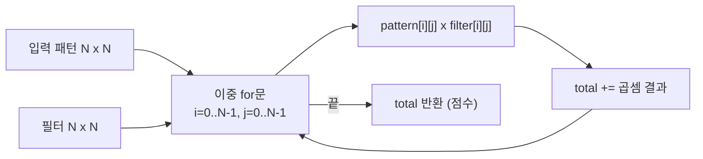

# Mini NPU Simulator 학습 노트 (Codyssey 미션2)

> AI가 계산하는 방식을 흉내 내는 작은 계산기 만들기
> 이 문서는 구현 전에 읽고, 구현하면서 평가 항목을 하나씩 체크하기 위한 **학습용 README**입니다.
> 구현이 끝나면 맨 아래 [결과 리포트] 섹션을 실제 결과로 채워 제출합니다.

---

## 0. 한눈에 보기

| 항목 | 내용 |
|---|---|
| 만드는 것 | Python 콘솔 앱 1개 (`main.py`) |
| 핵심 연산 | MAC (Multiply-Accumulate: 곱하고 더하기) |
| 모드 1 | 3×3 필터 2개 + 패턴 1개를 직접 입력 → 점수/판정/시간 |
| 모드 2 | `data.json` 일괄 판정 (5×5, 13×13, 25×25) → PASS/FAIL + 요약 |
| 성능 분석 | 크기별 10회 반복 평균 시간(ms) + 연산 횟수(N²) |
| 제약 | Python 3.8+, 표준 라이브러리만(json, time 등), NumPy 금지 |
| 제출물 | `main.py`, `README.md` |

---

## 1. 핵심 용어 ELI5 (5살에게 설명하듯)

### 1-1. 패턴 / 필터 / 배열

| 용어 | 쉬운 설명 | 이 미션에서는 |
|---|---|---|
| **패턴(Pattern)** | 검사받을 그림. 컴퓨터는 눈이 없어서 그림을 숫자판으로 받는다. | `0 1 0 / 1 1 1 / 0 1 0` 같은 2차원 숫자판 |
| **필터(Filter)** | "이런 모양이 정답이야" 하고 만들어 둔 **모범 답안 도장**. | 십자가 필터, X 필터 |
| **2차원 배열** | 줄(행)과 칸(열)이 있는 **바둑판/엑셀 표**. | `[[0,1,0],[1,1,1],[0,1,0]]` |
| **n×n** | 가로·세로 칸 수가 같은 정사각형 표. | 3×3, 5×5, 13×13, 25×25 |

### 1-2. 계산 관련

| 용어 | 쉬운 설명 | 예시 |
|---|---|---|
| **MAC 연산** | 도장을 그림 위에 겹치고, **같은 자리끼리 곱한 뒤 전부 더하는 것.** (Multiply + Accumulate) | 3×3이면 곱셈 9번 + 덧셈 |
| **점수(Score)** | 도장과 그림이 **얼마나 겹치는지** 나타낸 숫자. 클수록 닮았다. | 십자가 필터에 십자가 → 5점 |
| **유사도** | "얼마나 닮았나"를 말하는 어른 말. 여기서는 MAC 점수가 곧 유사도. | 5점 vs 1점 → 5점이 더 닮음 |
| **판정(Decision)** | 두 도장 중 점수가 더 높은 쪽이 "정답"이라고 선언하는 것. | Cross / X / UNDECIDED |

**왜 곱하면 닮은 정도가 나올까?**
곱셈은 "둘 다 1일 때만 1"이 됩니다. 그림이 색칠된 칸(1)과 도장이 색칠된 칸(1)이 **겹친 자리만** 점수가 올라갑니다. 겹치는 칸이 많을수록 점수가 커지니 "더 닮았다"가 됩니다.

### 1-3. 데이터/라벨 관련

| 용어 | 쉬운 설명 | 이 미션에서는 |
|---|---|---|
| **JSON** | 컴퓨터끼리 주고받는 **정리된 쪽지 양식**. 이름표(키)와 값이 짝지어 있다. | `data.json` |
| **스키마(Schema)** | 쪽지를 **어떤 모양으로 써야 하는지 정한 규칙**. | `filters`, `patterns`, `input`, `expected` |
| **키(Key)** | 서랍에 붙은 **이름표**. | `size_5`, `size_13_1` |
| **라벨(Label)** | "이 그림은 십자가야" 같은 **정답 이름표**. | `+`, `x`, `cross` |
| **정규화(Normalize)** | 사람마다 다르게 쓴 이름표를 **하나의 표준 이름으로 통일**하는 것. 별명이 여러 개여도 본명으로 바꿔 부르기. | `+`→`Cross`, `x`→`X`, `cross`→`Cross` |
| **표준 라벨** | 프로그램 안에서만 쓰기로 약속한 본명. | `Cross`, `X` |

**왜 정규화가 필요할까?** 필터 키는 `cross`인데 정답은 `+`로 적혀 있으면, 컴퓨터는 `"cross" == "+"`를 **다르다**고 봅니다. 사실은 같은 뜻인데 FAIL이 나는 억울한 상황을 막기 위해 먼저 이름을 통일합니다.

### 1-4. 숫자 비교 관련

| 용어 | 쉬운 설명 | 예시 |
|---|---|---|
| **부동소수점(float)** | 컴퓨터가 소수를 저장하는 방식. 2진수로 저장하다 보니 **0.1 같은 수를 정확히 못 담고 아주 조금 어긋난다.** | `0.1 + 0.2 = 0.30000000000000004` |
| **부동소수점 오차** | 위처럼 생기는 **눈에 안 보이는 작은 오차**. | `0.9000000000000000` vs `0.8999999999999999` |
| **허용오차(epsilon)** | "이 정도 차이는 **같은 걸로 쳐주자**"는 기준선. | `1e-9` (0.000000001) |
| **동점** | 두 점수의 차이가 epsilon보다 작은 경우. | `abs(a-b) < 1e-9` → UNDECIDED |

**왜 `a == b`로 비교하면 안 될까?** 눈으로는 둘 다 0.9인데 컴퓨터는 마지막 자리 때문에 "다르다"고 판단할 수 있습니다. 그래서 "차이가 아주 작으면 같다"로 비교합니다.

### 1-5. 성능 관련

| 용어 | 쉬운 설명 | 예시 |
|---|---|---|
| **연산 횟수** | 곱셈을 몇 번 했는지. | N×N 크기면 N² 번 |
| **시간 복잡도 O(N²)** | 그림 **한 변이 2배**가 되면 일은 **4배**가 된다는 법칙. | 5→10이면 25→100번 |
| **I/O** | 입력/출력/파일 읽기. 계산이 아니라 **기다림**이 많은 작업. | `input()`, `print()`, `json.load()` |
| **반복 측정 후 평균** | 한 번만 재면 우연히 빠르거나 느릴 수 있으니 **10번 재서 평균**을 낸다. | 10회 평균(ms) |
| **ms(밀리초)** | 1000분의 1초. | 0.012 ms |

### 1-6. 하드웨어 관련

| 용어 | 쉬운 설명 |
|---|---|
| **CPU (직렬 처리)** | **똑똑한 요리사 1명.** 복잡한 요리를 순서대로 하나씩 잘 만들지만, 감자 1만 개를 깎으라고 하면 오래 걸린다. |
| **NPU (병렬 처리)** | **감자 깎는 일꾼 수천 명.** 한 가지 단순 작업(곱하고 더하기)을 동시에 엄청 많이 한다. |
| **병렬 처리** | 여러 계산을 **한꺼번에** 하는 것. |

---

## 2. 전체 구현 흐름 도식화

### 2-1. 프로그램 전체 흐름



### 2-2. 모드 1: 사용자 입력 (3×3)



### 2-3. 모드 2: data.json 분석


> UNDECIDED는 모드 2에서 **무조건 FAIL로 집계**합니다. (expected는 Cross 또는 X뿐이라 UNDECIDED와 절대 같을 수 없음)

### 2-4. MAC 연산 내부 (평가 항목 2-1)



### 2-5. 시간 측정 경계 (평가 항목 2-4)

```
 입력/파일 읽기 (I/O)        ← 측정 제외
        │
        ▼
 start = time.perf_counter()  ┐
 for _ in range(10):          │  측정 구간
     mac(pattern, filter)     │  (순수 연산 함수 호출만)
 end = time.perf_counter()    ┘
        │
        ▼
 평균(ms) = (end - start) / 10 * 1000
        │
        ▼
 print(...)                   ← 측정 제외
```

### 2-6. 크기 증가와 연산량 (O(N²) 직관)

```
 3x3    ■■■              9번
        ■■■
        ■■■

 5x5    ■■■■■           25번   (3→5 : 1.67배 커졌는데 일은 2.8배)
        ■■■■■
        ■■■■■
        ■■■■■
        ■■■■■

 13x13  → 169번
 25x25  → 625번         (3→25 : 8.3배 커졌는데 일은 약 69배)
```

한 변이 k배 → 연산 횟수는 k² 배. 이것이 O(N²)입니다.

---

## 3. 권장 코드 구조 (함수 단위)

| 함수 | 역할 | 연결되는 평가 항목 |
|---|---|---|
| `normalize_label(raw)` | `+`/`cross` → `Cross`, `x` → `X` 로 통일. 모르는 값은 예외 또는 None | 1-5, 2-3 |
| `mac(pattern, filt)` | 이중 반복문으로 곱하고 누적, 점수 반환 | 2-1, 3-1 |
| `compare_scores(a, b, eps=1e-9)` | 차이가 eps 미만이면 동점 | 3-3, 3-4 |
| `parse_matrix_line(line, n)` | 한 줄 → 숫자 리스트, 개수/파싱 검증 | 1-3 |
| `read_matrix_from_console(name, n=3)` | n줄 입력, 오류 시 재입력 | 1-3 |
| `extract_size(key)` | `size_13_1` → `13` | 1-4, 2-2 |
| `validate_case(filt, pattern)` | 크기·스키마 검증, 실패 사유 문자열 반환 | 1-4 |
| `measure_mac(pattern, filt, repeat=10)` | perf_counter로 평균 ms | 2-4, 3-2 |
| `run_mode1()` / `run_mode2()` | 각 모드 흐름 | 1-1, 1-2 |
| `print_perf_table(rows)` | 크기/평균 ms/N² 표 | 1-7 |
| `main()` | 모드 선택 | |

### 핵심 의사코드

```python
def mac(pattern, filt):
    n = len(pattern)
    total = 0.0
    for i in range(n):
        for j in range(n):
            total += pattern[i][j] * filt[i][j]
    return total


def judge(score_a, score_b, label_a, label_b, eps=1e-9):
    if abs(score_a - score_b) < eps:
        return "UNDECIDED"
    return label_a if score_a > score_b else label_b
```

### data.json 기대 구조 (과제 설명 기준)

```
{
  "filters":  { "size_5": {"cross": [[...]], "x": [[...]]}, "size_13": {...}, "size_25": {...} },
  "patterns": { "size_5_1": {"input": [[...]], "expected": "+"}, ... }
}
```

> 실제 파일의 키 이름과 모양을 먼저 눈으로 확인하세요. 위는 과제 설명을 바탕으로 한 예상 구조이므로 실제와 다르면 파싱 코드를 맞춰야 합니다.

---

## 4. 평가 항목별 학습 가이드

### 항목 1. 기능 동작 검증 (직접 실행해서 확인)

| # | 확인 방법 |
|---|---|
| 1-1 | 십자가/X/X패턴 입력 → A 1.0, B 5.0, 판정 B, 시간 출력 |
| 1-2 | 동점이 나오는 값(예: 필터 두 개를 똑같이 입력) → "판정 불가" |
| 1-3 | 줄에 숫자 2개 입력, `a b c` 입력 → 안내 후 재입력 |
| 1-4 | `size_13_1` → N=13 추출 → `size_13` 필터 선택 로그 확인 |
| 1-5 | expected `+`/`x`, 필터 키 `cross`/`x` → 출력이 항상 `Cross`/`X` |
| 1-6 | 동점 케이스 → `UNDECIDED` 출력 + FAIL 집계 |
| 1-7 | 크기/평균 ms/N² 표 (각 10회 평균) |
| 1-8 | 총/통과/실패 + 실패 케이스 이유 |
| 1-9 | README에 결과 리포트 10줄 이상 |

**의도적 오류 테스트도 꼭 해보세요:** 일부러 크기 안 맞는 패턴, 빈 줄, 문자 섞인 입력을 넣어도 프로그램이 죽지 않아야 합니다.

### 항목 2. 코드 구조 및 설계 (말로 설명 연습)

- **MAC 흐름**: 입력(패턴+필터) → 같은 위치끼리 곱셈 → 총합에 누적 → 점수 반환.
- **키에서 N 추출**: `size_13_1`을 `_`로 쪼개 두 번째 조각을 정수로 변환 → `filters["size_13"]` 선택.
- **normalize_label 분리 이유**: 변환 규칙이 한 곳에만 있으면 (1) 새 라벨 추가 시 한 곳만 고치고 (2) 중복 코드가 없고 (3) 단독 테스트가 쉽다.
- **시간 측정 경계**: `mac()` 호출 구간만 `perf_counter`로 감싸고 input/print/json 로드는 밖에 둔다.

### 항목 3. 핵심 기술 원리 (말로 설명 연습)

- **점수가 높을수록 닮은 이유**: 1과 1이 겹치는 칸만 점수에 더해지므로, 겹침이 많을수록 합이 커진다.
- **O(N²)**: 이중 반복문이 N×N번 돈다. 한 변이 2배면 시간도 약 4배. 표의 연산 횟수 열과 평균 시간 열을 나란히 비교해 근거로 삼는다. (작은 크기에서는 함수 호출 오버헤드 때문에 완전히 4배가 되지 않을 수 있음)
- **부동소수점 오차**: 컴퓨터는 소수를 2진수로 저장해 일부 값을 정확히 표현하지 못한다. 그래서 `==` 대신 epsilon 비교가 필요하다.
- **동점 처리 모드 1 vs 모드 2가 다른 이유**: 모드 1은 "A/B 중 누구인지"만 알려주는 도구라 동점이면 **판정 불가**로 안내하면 충분하다. 모드 2는 **정답(expected)과 비교**하는 테스트라서 UNDECIDED는 정답과 일치할 수 없어 **FAIL로 집계**해야 한다. (출력 라벨도 A/B vs Cross/X로 다름)

### 항목 4. 심층 인터뷰 (답변 방향 메모)

1. **새 라벨 `o` 추가 시 확장 순서**
   정규화 규칙 추가(`normalize_label`) → 필터/데이터 구조 확장(`filters`에 o 필터) → 판정 로직을 "두 개 비교"에서 "여러 개 중 최대"로 일반화(동점 규칙 포함) → 출력 포맷 수정 → 테스트 케이스 추가.
2. **1000×1000 패턴**
   연산 횟수 100만 번(필터 1개당). 필터가 여러 개면 곱절. 파이썬 반복문은 느리므로 시간 문제, 2차원 리스트는 메모리 오버헤드 큼. 우선 최적화: 1차원 배열 변환(보너스), 라이브러리가 허용되면 벡터화(NumPy), 궁극적으로는 병렬 하드웨어(GPU/NPU).
3. **CPU 직렬 vs NPU 병렬**
   MAC은 각 곱셈이 서로 **독립적**이라 동시에 해도 된다. CPU는 순서대로 처리해서 N² 번을 차례로 기다려야 하고(병목), NPU는 수천 개의 MAC 유닛으로 동시에 처리한다. 추가로 메모리에서 데이터를 가져오는 속도(메모리 대역폭)도 병목이 될 수 있다.

### 항목 5. 보너스 (선택)

- **1차원 배열 최적화**: `flat = [v for row in m for v in row]` 후 단일 for문으로 `sum += p[k]*f[k]`. 동일 입력/동일 반복 횟수로 전/후 시간 비교.
- **패턴 생성기**: N을 받아 Cross(가운데 행 + 가운데 열), X(두 대각선) 자동 생성. 모드 1과 성능 분석에 재사용.

---

## 5. 구현 체크리스트

- [ ] `data.json` 실제 구조 확인
- [ ] `normalize_label` 작성 + 단독 테스트
- [ ] `mac` 작성 (외부 라이브러리 없이)
- [ ] 3×3 예제로 A=1.0 / B=5.0 확인
- [ ] 입력 검증(행/열, 숫자) + 재입력
- [ ] 동점 epsilon 처리
- [ ] 모드 2: 키에서 N 추출, 크기 검증, 케이스 단위 FAIL 처리
- [ ] 성능 측정(10회 평균), 표 출력
- [ ] 결과 요약(총/통과/실패/실패 목록)
- [ ] 의도적 오류 입력 테스트
- [ ] (보너스) 1차원 최적화, 패턴 생성기
- [ ] README 결과 리포트 10줄 이상 작성

---

## 6. 실행 방법 (구현 후 채우기)

```bash
python main.py
```

- 모드 선택: `1` 사용자 입력 / `2` data.json 분석
- `data.json` 위치: `main.py`와 같은 폴더

## 7. 구현 요약 (구현 후 채우기)

- 라벨 정규화 방식:
- MAC 연산 구현 개요:
- 동점 처리 정책(epsilon):

## 8. 결과 리포트 (구현 후 채우기, 최소 10줄)

### 8-1. 실패 원인 분석
(실패 케이스별로 **데이터/스키마 문제 vs 로직 문제 vs 수치 비교 문제** 중 어디인지 분류. 실패가 0이면 정규화와 epsilon 정책 덕분인 이유를 서술)

### 8-2. 성능 표 해석 + O(N²) 근거

| 크기 | 평균 시간(ms) | 연산 횟수(N²) |
|---|---|---|
| 3×3 | | 9 |
| 5×5 | | 25 |
| 13×13 | | 169 |
| 25×25 | | 625 |

(연산 횟수 증가 비율과 측정 시간 증가 비율을 비교하여 설명)
