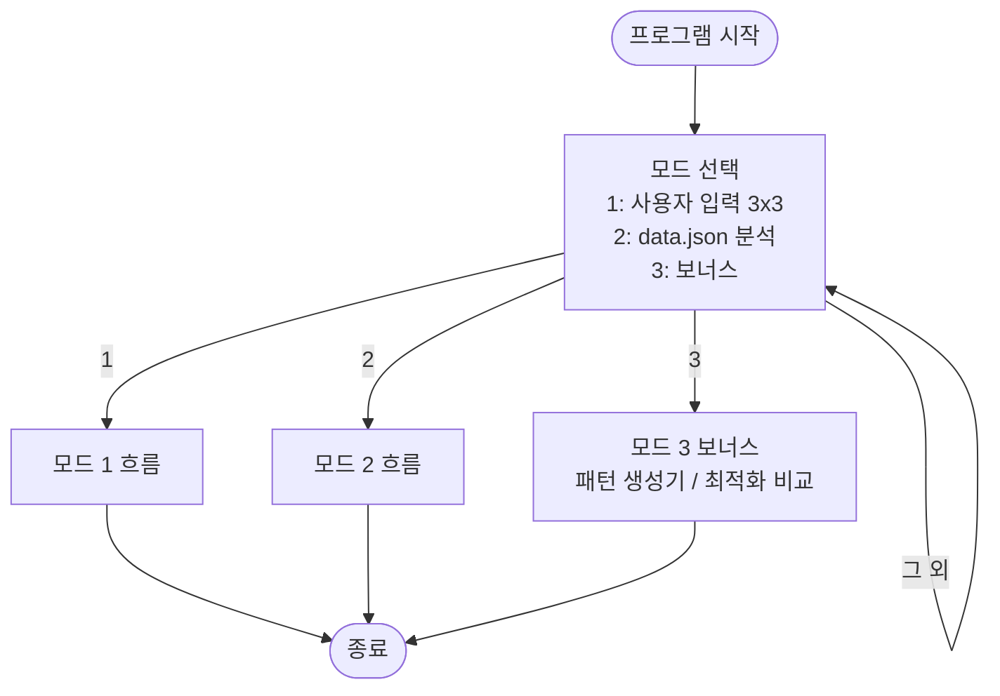
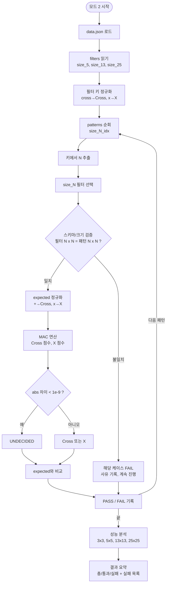
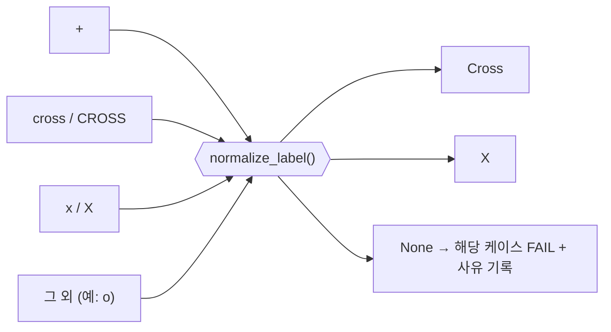
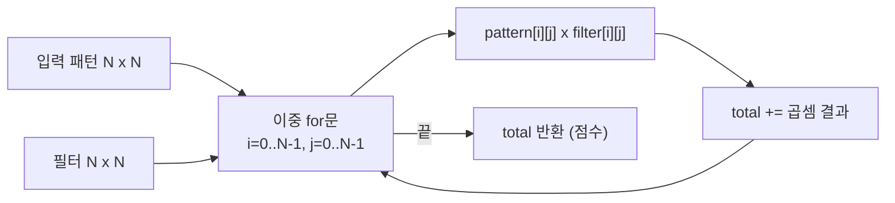
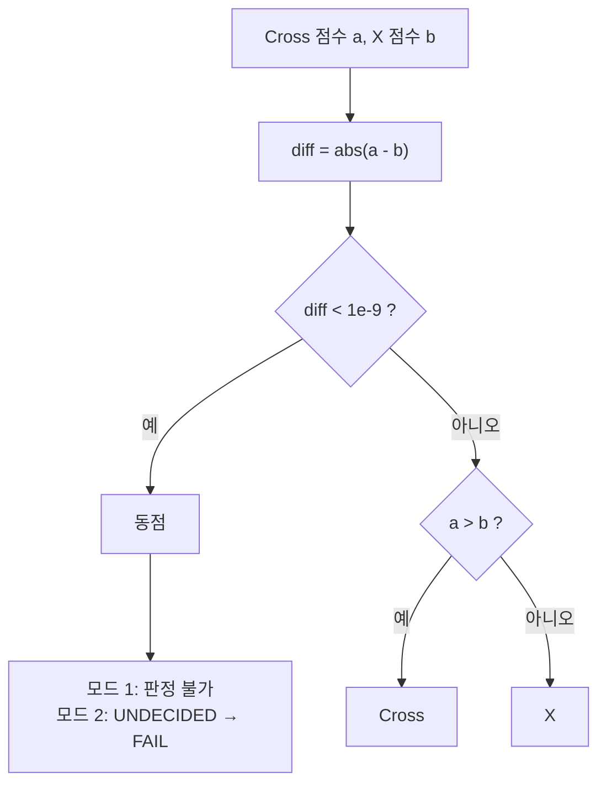
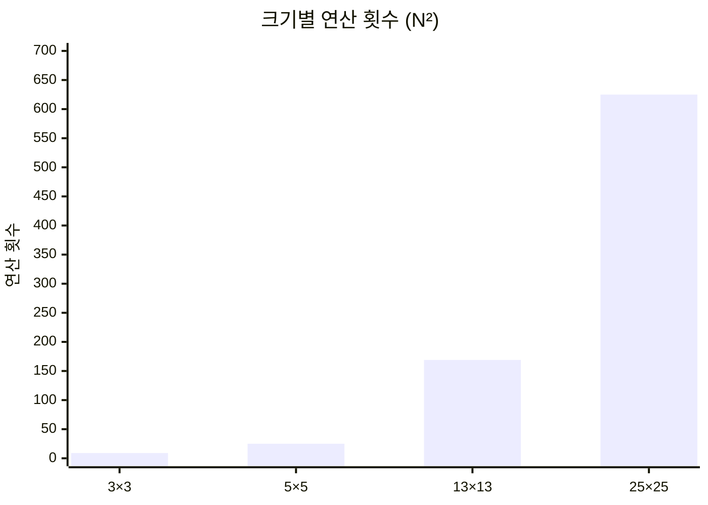
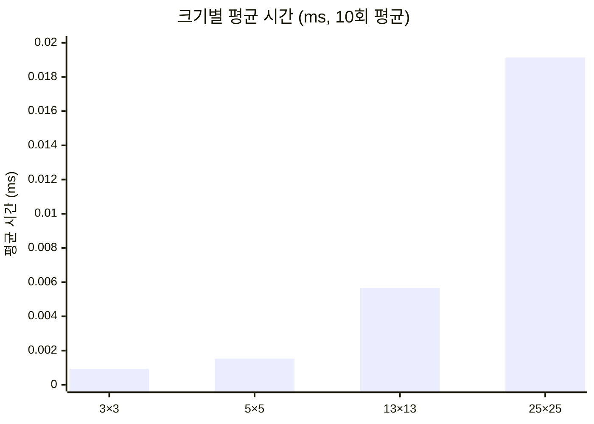
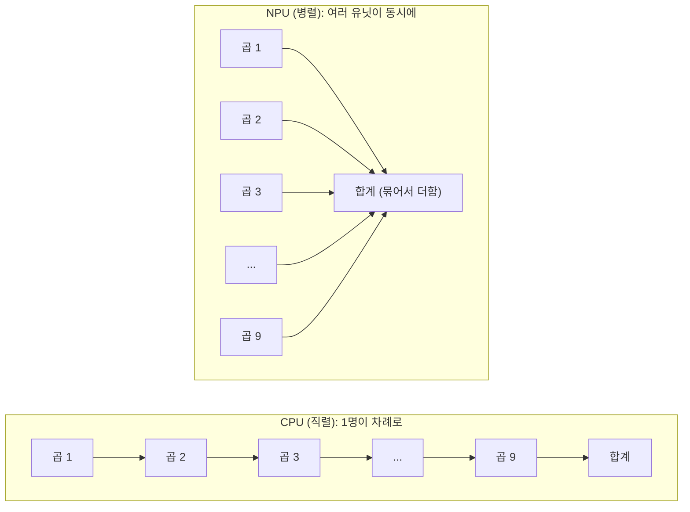
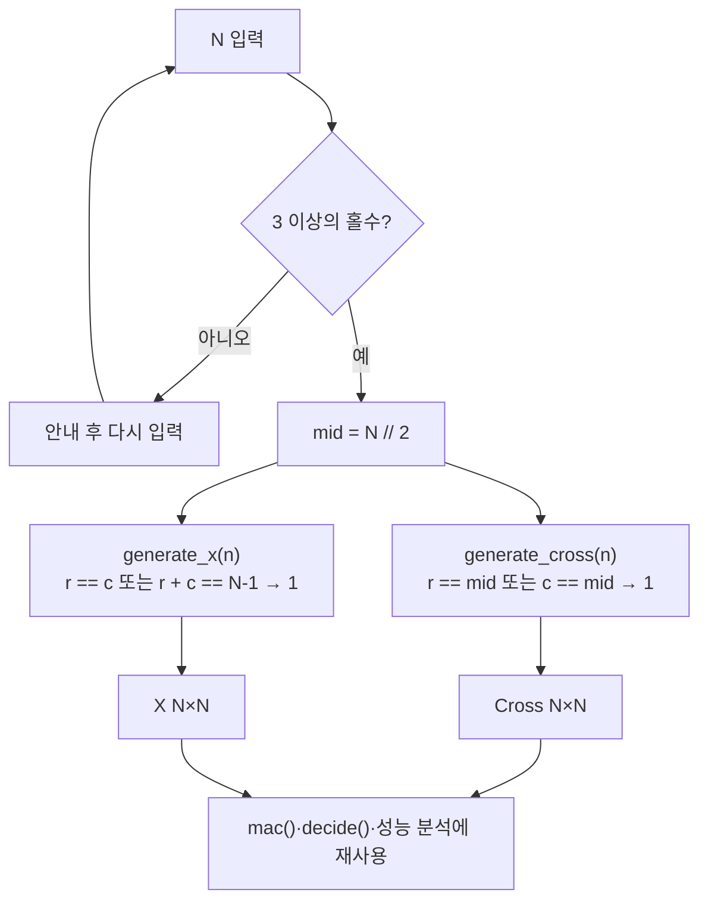

# Mini NPU 시뮬레이터 (Codyssey3-3)

3×3~25×25 패턴이 십자가(Cross)인지 X인지 MAC 연산으로 판별하고, 크기별 연산 시간을 측정하는 콘솔 시뮬레이터

## 목차

1. [프로젝트 개요](#1-프로젝트-개요)
2. [개발 환경](#2-개발-환경)
3. [실행 방법](#3-실행-방법)
4. [파일 구조](#4-파일-구조)
5. [구현 요약](#5-구현-요약)
6. [실행 예시](#6-실행-예시)
7. [결과 리포트](#7-결과-리포트)
8. [보너스 과제 (선택)](#8-보너스-과제-선택)
9. [제출물 체크리스트](#9-제출물-체크리스트)
10. [용어 설명 모음](#10-쉬운-설명-모음-eli5)

---

## 1. 프로젝트 개요

NPU의 핵심 연산인 **MAC(Multiply-Accumulate, 곱하고 누적해서 더하기)** 을 파이썬 반복문으로 직접 구현해, 입력 패턴이 십자가(Cross)인지 X인지 판별하는 콘솔 프로그램이다. 3×3부터 25×25까지의 크기를 처리하고, 크기가 커질 때 연산 시간이 어떻게 변하는지 측정한다.

- **모드 1**: 3×3 필터 2개(A, B)와 패턴을 직접 입력해 점수, 연산 시간, 판정을 확인한다.
- **모드 2**: `data.json`의 필터(5×5, 13×13, 25×25)와 패턴을 일괄 판정하고, 성능 분석과 결과 요약을 출력한다.
- **모드 3 (보너스)**: N×N 십자가·X 패턴을 자동 생성해 판정하고, 2차원 배열 MAC과 1차원 배열 MAC의 시간을 비교한다.



> 그림 1. 모드 선택부터 각 모드로 갈라지는 전체 흐름도 (모드별 상세 흐름은 [5-0](#5-0-처리-흐름도) 참고)

> **설명**: 컴퓨터는 눈이 없어서 그림을 "보지" 못한다. 그래서 그림을 숫자판(0과 1)으로 바꿔서 주고, "이 모양 도장(필터)과 얼마나 겹치나?"를 계산하게 한다. 겹치는 칸이 많은 도장이 정답. 이 프로그램은 그 계산을 직접 만들어 보고, 그림이 커질수록 계산이 얼마나 오래 걸리는지 재어 보는 연습임.

---

## 2. 개발 환경

| 항목 | 내용 |
|---|---|
| OS | Ubuntu on WSL |
| 에디터 | VS Code (WSL 연결) |
| Python | Python 3.12.8, 필요 버전 3.8 이상 |
| 외부 라이브러리 | 없음 (`json`, `math`, `os`, `time` 표준 라이브러리만 사용) |

---

## 3. 실행 방법

`main.py`와 `data.json`이 있는 폴더(프로젝트 루트)에서 실행한다.

```bash
python3 main.py
```

실행하면 모드를 선택한다.

```
=== Mini NPU Simulator ===
[모드 선택]
1. 사용자 입력 (3x3)
2. data.json 분석
3. 보너스 (패턴 생성기, 최적화 비교)
선택:
```

- **모드 1**: 필터 A, 필터 B, 패턴을 각각 3줄로 입력한다. 한 줄에 숫자 3개를 공백으로 구분해 입력하고 Enter를 누른다. (예: `0 1 0`)
- **모드 2**: 별도 입력 없이 `data.json`을 읽어 자동으로 분석한다. `data.json`은 `main.py`와 같은 폴더에 있어야 한다.
- **모드 3 (보너스)**: 보너스 메뉴에서 1(패턴 생성기, 3 이상의 홀수 N 입력) 또는 2(최적화 전/후 비교)를 고른다. 3을 입력하면 종료한다.

---

## 4. 파일 구조

```
Codyssey_1-3/
├── main.py       # 메인 실행 파일 (모드 1, 모드 2, 보너스 모드 3, 성능 분석)
├── data.json     # 모드 2에서 읽는 필터와 패턴 데이터
├── README.md     # 이 문서
└── .gitignore    # Git이 추적하지 않을 파일 목록
```

---

## 5. 구현 요약

### 5-0. 처리 흐름도

**모드 1: 사용자 입력 (3×3)**


**모드 2: data.json 분석**



> UNDECIDED는 모드 2에서 항상 FAIL로 집계한다. `expected`는 Cross 또는 X뿐이라 UNDECIDED와 같을 수 없기 때문이다.

> **설명**: 모드 1은 "내가 고른 두 도장 중 어느 쪽이 더 닮았나?"를 묻는 놀이이고, 모드 2는 "정답지가 있는 시험 문제를 한꺼번에 채점"하는 것임. 채점 중에 문제 하나가 이상해도 시험 전체가 멈추지 않고, 그 문제만 틀림(FAIL) 처리하고 다음으로 넘어감.

### 5-1. 데이터 구조

패턴과 필터는 파이썬의 2차원 리스트(`grid[행][열]`)로 저장한다. 위치 값은 `grid[r][c]`로 읽고 쓰며, 3×3, 5×5, 13×13, 25×25 크기를 같은 코드로 처리한다.

코드로 보면 이렇다.

```python
grid = [
    [0, 1, 0],   # 행 0
    [1, 1, 1],   # 행 1
    [0, 1, 0],   # 행 2
]
```

각 칸의 위치는 이렇게 대응된다.

```
              c=0         c=1         c=2
          ┌───────────┬───────────┬───────────┐
   r=0    │     0     │     1     │     0     │
          │  [0][0]   │  [0][1]   │  [0][2]   │
          ├───────────┼───────────┼───────────┤
   r=1    │     1     │     1     │     1     │
          │  [1][0]   │  [1][1]   │  [1][2]   │
          ├───────────┼───────────┼───────────┤
   r=2    │     0     │     1     │     0     │
          │  [2][0]   │  [2][1]   │  [2][2]   │
          └───────────┴───────────┴───────────┘

  읽기: grid[1][2]    → 행 1, 열 2 의 값 (1)
  쓰기: grid[0][0] = 1 → 행 0, 열 0 의 값을 바꿈

  N = len(grid)  → 3×3, 5×5, 13×13, 25×25 모두 같은 코드로 처리
```

> 그림 2. 2차원 리스트 `grid[r][c]` — 코드와 격자를 나란히 놓아 행(r)·열(c) 인덱스가 실제 칸 위치와 어떻게 대응되는지 보여준다. 크기 N은 리스트의 행·열 개수만 바뀔 뿐 MAC 코드는 그대로라는 점이 핵심이다.

### 5-2. 라벨 정규화

`normalize_label()`이 입력 라벨을 표준 라벨 두 가지(`Cross`, `X`)로 바꾼다. `+`, `cross`(대소문자 무시)는 `Cross`, `x`는 `X`로 바꾸고, 그 외는 `None`으로 처리한다. `data.json`의 필터 키(`cross`, `x`)와 expected 값(`+`, `x`) 모두에 적용하며, 출력과 PASS/FAIL 비교는 표준 라벨만 사용한다. (예: `+`, `cross`, `CROSS` → `Cross`, `x`, `X` → `X`)



적용 위치는 두 곳이다.

```
 data.json 필터 키 (cross, x)    ─┐
                                  ├─▶ normalize_label() ─▶ 표준 라벨 (Cross, X)
 data.json expected 값 (+, x)    ─┘                         │
                                                            ▼
                                            출력, PASS/FAIL 비교는 표준 라벨만 사용
```

> 그림 3. 표기가 제각각인 라벨이 `normalize_label()`을 거쳐 표준 라벨(Cross, X)로 통일되는 과정

> **설명**: 같은 친구를 어떤 사람은 "철수", 어떤 사람은 "찰스"라고 부르는 것과 같다. 컴퓨터는 이름이 다르면 다른 사람으로 보기 때문에, 비교하기 전에 먼저 "본명"(Cross, X) 하나로 통일해 준다.

### 5-3. MAC 연산

`mac()`이 패턴과 필터를 이중 반복문으로 순회하며 같은 위치의 값을 곱해 누적한다. NumPy 같은 외부 라이브러리는 사용하지 않았다.

흐름: 입력(패턴, 필터) → 위치별 곱셈 → 누적 합산 → 점수 반환



> 그림 4. `mac()`의 이중 반복문이 같은 위치의 값을 곱해 `total`에 누적하는 과정

> **설명**: 도장을 그림 위에 겹쳐 놓고, 같은 자리에 있는 두 숫자를 곱한 다음 전부 더한다. 곱셈은 "둘 다 1일 때만 1"이라서, 그림과 도장이 **같이 칠해진 칸**만 점수가 된다. 점수가 클수록 많이 겹치고, 그래서 더 닮았다는 뜻임.

### 5-4. 점수 비교 정책 (epsilon)

`abs(점수1 - 점수2) < 1e-9`이면 동점으로 본다. 모드 1은 `판정 불가`, 모드 2는 `UNDECIDED`로 출력한다.

모드별로 동점 처리가 다른 이유는 두 모드의 목적이 다르기 때문이다.

| 구분 | 목적 | 동점일 때 |
|---|---|---|
| 모드 1 | 사용자가 넣은 필터 A, B 중 어느 쪽에 가까운지 알려주는 도구 | 어느 쪽도 고를 근거가 없으므로 `판정 불가`로 안내하면 충분하다 |
| 모드 2 | 판정 결과를 `expected`와 비교해 PASS/FAIL을 가르는 테스트 | `expected`는 Cross 또는 X뿐이라 UNDECIDED와 절대 같을 수 없으므로 **FAIL로 집계**한다 |



실제 값으로 보면 이렇다.

```
 size_5_1 :  0.9  vs  0.8999999999999999
             차이 ≈ 1.1e-16   <   1e-9   →  동점 (UNDECIDED)

 size_13_2:  7.499999999999997  vs  7.5
             차이 ≈ 3e-15     <   1e-9   →  동점 (UNDECIDED)
```

> 그림 5. 두 점수의 차이가 epsilon(1e-9) 미만이면 동점으로 묶어 판정을 보류하는 과정

> **설명**: 컴퓨터는 소수를 저장할 때 아주 조금씩 어긋나서, 사람 눈에 똑같은 0.9가 `0.9`와 `0.8999999999999999`로 달라질 수 있다. 그래서 "차이가 머리카락 한 올(1e-9)보다 작으면 같은 걸로 치자"라는 기준선(epsilon)을 둠.

### 5-5. 입력과 스키마 검증

- **모드 1**: 줄마다 열 개수와 숫자 변환을 검사하고, `nan`/`inf`는 거부한다. 틀린 줄만 안내 문구(`입력 형식 오류: ...`)와 함께 다시 입력받는다.
- **모드 2**: 케이스마다 키(크기 N) → 필터 존재 → `input`/`expected` 항목 → 라벨 → 패턴 크기 순서로 검사한다. 문제가 있으면 그 케이스만 FAIL과 사유를 남기고 프로그램은 계속 진행한다. 파일이 없거나 JSON 문법이 틀려도 안내 후 정상 종료한다.

### 5-6. 설계 의사결정 요약

**패턴 키에서 N을 추출해 필터를 고르는 방법**
패턴 키 `size_13_1`을 `_`로 나눈 두 번째 조각(`13`)을 정수로 바꿔 N을 얻고, `size_{N}` 필터를 찾는다. N을 정수로 바꿀 수 없거나 해당 필터가 없으면 그 케이스만 FAIL 처리한다. 키 규칙에 의존하는 부분을 이 한 곳에 모아, 키 형식이 바뀌어도 고칠 곳이 한 군데로 줄어든다.

**`normalize_label()`을 별도 함수로 분리한 이유**
- 변환 규칙이 한 곳에만 있어, 새 표기가 생기면 이 함수만 고치면 된다.
- 필터 키와 expected 값 양쪽에서 같은 규칙을 재사용하므로 두 값이 서로 다르게 해석될 일이 없다.
- 함수 하나만 따로 불러 `+`, `cross`, `CROSS`, `x`가 기대한 값으로 바뀌는지 단독 테스트하기 쉽다.

**시간 측정 경계**
`input()`, `print()`, `json.load()` 같은 I/O는 측정에서 제외하고, `time.perf_counter()`로 `mac()` 호출 구간만 감싸 10회 반복한 평균(ms)을 구한다. 입출력 대기 시간이 섞이면 연산 시간이 부풀려져 크기별 비교가 흐려지기 때문이다.

```
 입력/파일 읽기 (I/O)         ← 측정 제외
        │
        ▼
 start = time.perf_counter()  ┐
 for _ in range(10):          │  측정 구간
     mac(pattern, filter)     │  (순수 연산 함수 호출만)
 end = time.perf_counter()    ┘
        │
        ▼
 평균(ms) = (end - start) / 10 * 1000
        │
        ▼
 print(...)                   ← 측정 제외
```

> **설명**: 달리기 기록을 잴 때 신발 끈 묶는 시간은 빼고, 출발선에서 결승선까지만 재는 것과 같다. 한 번만 재면 우연히 빠르거나 느릴 수 있어서 10번 재서 평균을 냄.

**MAC 점수가 높을수록 더 유사한 이유**
곱셈은 두 값이 모두 1일 때만 1이 되므로, 패턴에서 칠해진 칸과 필터에서 칠해진 칸이 겹친 위치만 점수에 더해진다. 겹치는 칸이 많을수록 합이 커지므로 점수가 높은 필터가 패턴과 더 닮았다고 볼 수 있다.

### 5-7. 새 라벨을 추가하는 절차

현재 프로그램은 Cross와 X 두 라벨만 비교한다. 새 라벨(예: Triangle)을 추가하려면 아래 순서로 고친다.

1. **정규화 규칙 추가**: `normalize_label()`에 새 표기를 표준 라벨로 바꾸는 규칙을 넣는다. (예: `"triangle"`, `"^"` → `"Triangle"`)
2. **필터 추가**: `data.json`의 `filters` 각 크기(`size_5` 등)에 새 라벨의 필터 격자를 넣는다.
3. **필터 검사 조건 수정**: `load_filters()`가 `set(standard) != {"Cross", "X"}`로 라벨이 정확히 두 개인지 검사하므로, 새 라벨을 포함하도록 고친다.
4. **판정 로직 확장**: `decide()`는 점수 두 개만 비교한다. 라벨이 셋 이상이면 모든 필터 점수를 구해 가장 높은 점수의 라벨을 고르고, 1등과 2등의 차이가 `EPSILON` 미만이면 UNDECIDED로 처리하도록 바꾼다.
5. **출력 수정**: `run_case()`와 `print_case()`가 Cross, X 점수만 출력하므로 새 라벨 점수도 출력하도록 고친다.
6. **테스트 케이스 작성**: `patterns`에 새 라벨 패턴과 expected 값을 추가하고, 실행해서 PASS/FAIL이 기대대로 나오는지 확인한다.

정규화(1단계)와 필터 검사(3단계)를 빠뜨리면 새 라벨이 `None`이나 형식 오류로 처리되어 케이스 단위 FAIL이 되므로, 실패 사유 메시지로 어느 단계가 빠졌는지 확인할 수 있다.

---

## 6. 실행 예시

### 6-1. 모드 1 (3×3 사용자 입력)

```
=== Mini NPU Simulator ===
[모드 선택]
1. 사용자 입력 (3x3)
2. data.json 분석
3. 보너스 (패턴 생성기, 최적화 비교)
선택: 1
#---------------------------------------
# [1] 필터 입력
#---------------------------------------
필터 A (3줄 입력, 공백 구분)
0 1 0
1 1 1
0 1 0
필터 B (3줄 입력, 공백 구분)
1 0 1
0 1 0
1 0 1
✓ 필터 A, B 저장 완료
필터 A:
  0.0 1.0 0.0
  1.0 1.0 1.0
  0.0 1.0 0.0
필터 B:
  1.0 0.0 1.0
  0.0 1.0 0.0
  1.0 0.0 1.0
#---------------------------------------
# [2] 패턴 입력
#---------------------------------------
패턴 (3줄 입력, 공백 구분)
1 0 1
0 1 0
1 0 1
#---------------------------------------
# [3] MAC 결과
#---------------------------------------
A 점수: 1.0
B 점수: 5.0
연산 시간(평균/10회): 0.000963 ms
판정: B
#---------------------------------------
# [4] 성능 분석 (3×3, 평균/10회)
#---------------------------------------
크기        평균 시간(ms)         연산 횟수(N²)
--------------------------------------
3×3       0.000470          9
```

필터 A는 십자가, 필터 B는 X이고 패턴은 X이다. 패턴이 X 필터와 일치해 B 점수(5.0)가 A 점수(1.0)보다 높고, 판정은 B이다.

### 6-2. 모드 1 동점 (판정 불가)

필터 A와 B에 같은 십자가 필터를 넣고, 패턴도 십자가를 입력한 경우이다. 두 점수가 같아 어느 쪽도 고르지 못하므로 `판정 불가`가 출력된다.

```
#---------------------------------------
# [3] MAC 결과
#---------------------------------------
A 점수: 5.0
B 점수: 5.0
연산 시간(평균/10회): 0.000950 ms
판정: 판정 불가 (|A-B| < 1e-9)
```

> 위 출력은 형식 예시이다. 실제 제출 시 직접 실행한 결과로 교체한다. (시간 값은 실행할 때마다 달라진다.)

### 6-3. 모드 1 입력 오류와 재입력

열 개수가 맞지 않거나 숫자가 아닌 값을 입력하면 안내 문구를 출력하고, 틀린 줄만 다시 입력받는다.

```
필터 A (3줄 입력, 공백 구분)
0 1
입력 형식 오류: 각 줄에 3개의 숫자를 공백으로 구분해 입력하세요.
0 1 0
1 a 1
입력 형식 오류: 각 줄에 3개의 숫자를 공백으로 구분해 입력하세요.
1 1 1
0 1 0
✓ 필터 A 저장 완료
```

> 위 출력도 형식 예시이다. 실제 프로그램의 문구와 동작대로 교체한다.

### 6-4. 모드 2 (data.json 분석)

```
=== Mini NPU Simulator ===
[모드 선택]
1. 사용자 입력 (3x3)
2. data.json 분석
3. 보너스 (패턴 생성기, 최적화 비교)
선택: 2
#---------------------------------------
# [1] 필터 로드
#---------------------------------------
✓ size_5 필터 로드 완료 (Cross, X)
✓ size_13 필터 로드 완료 (Cross, X)
✓ size_25 필터 로드 완료 (Cross, X)
#---------------------------------------
# [2] 패턴 분석 (라벨 정규화 적용)
#---------------------------------------
--- size_5_1 ---
Cross 점수: 0.9
X 점수: 0.8999999999999999
판정: UNDECIDED | expected: X | FAIL
  사유: 동점(UNDECIDED) 처리 규칙에 따라 FAIL
--- size_5_2 ---
Cross 점수: 8.9
X 점수: 0.1
판정: Cross | expected: Cross | PASS
--- size_13_1 ---
Cross 점수: 0.3
X 점수: 14.700000000000008
판정: X | expected: X | PASS
--- size_13_2 ---
Cross 점수: 7.499999999999997
X 점수: 7.5
판정: UNDECIDED | expected: Cross | FAIL
  사유: 동점(UNDECIDED) 처리 규칙에 따라 FAIL
--- size_25_1 ---
Cross 점수: 4.9
X 점수: 4.899999999999999
판정: UNDECIDED | expected: X | FAIL
  사유: 동점(UNDECIDED) 처리 규칙에 따라 FAIL
--- size_25_2 ---
Cross 점수: 52.9
X 점수: 0.1
판정: Cross | expected: Cross | PASS
#---------------------------------------
# [3] 성능 분석 (평균/10회)
#---------------------------------------
크기        평균 시간(ms)         연산 횟수(N²)
--------------------------------------
3×3       0.000932          9
5×5       0.001530          25
13×13     0.005662          169
25×25     0.019141          625
#---------------------------------------
# [4] 결과 요약
#---------------------------------------
총 테스트: 6개
통과: 3개
실패: 3개
실패 케이스:
- size_5_1: 동점(UNDECIDED) 처리 규칙에 따라 FAIL
- size_13_2: 동점(UNDECIDED) 처리 규칙에 따라 FAIL
- size_25_1: 동점(UNDECIDED) 처리 규칙에 따라 FAIL
```

---

## 7. 결과 리포트

### 7-1. 테스트 결과 요약

`data.json` 분석 결과는 총 6개 중 통과 3개, 실패 3개이다.

| 케이스 | Cross 점수 | X 점수 | 판정 | expected | 결과 |
|---|---|---|---|---|---|
| size_5_1 | 0.9 | 0.8999999999999999 | UNDECIDED | X | FAIL |
| size_5_2 | 8.9 | 0.1 | Cross | Cross | PASS |
| size_13_1 | 0.3 | 14.700000000000008 | X | X | PASS |
| size_13_2 | 7.499999999999997 | 7.5 | UNDECIDED | Cross | FAIL |
| size_25_1 | 4.9 | 4.899999999999999 | UNDECIDED | X | FAIL |
| size_25_2 | 52.9 | 0.1 | Cross | Cross | PASS |

### 7-2. 실패 원인 분석

실패 3개(size_5_1, size_13_2, size_25_1)는 모두 두 필터의 점수가 사실상 같아 UNDECIDED가 된 경우이다. 원인을 세 가지로 나누어 진단했다.

| 구분 | 진단 | 근거 |
|---|---|---|
| 데이터/스키마 문제 (형식) | 해당 없음 | 모든 라벨이 정규화되었고, 6개 케이스의 패턴과 필터 크기가 일치했다. |
| 데이터 구성 | **해당 (근본 원인)** | 필터에 0.9, 4.9, 7.5처럼 1이 아닌 값이 섞여 있어, 세 케이스는 두 필터가 패턴을 구별하지 못하는 **실제 동점**이다. |
| 로직 문제 | 해당 없음 | 모드 1에서 십자가·X 필터와 X 패턴으로 A=1.0, B=5.0이 나와 MAC과 판정이 맞았고, 정상 케이스 3개는 PASS였다. |
| 수치 비교 문제 | 원인이 아님 | 0.9와 0.8999999999999999 같은 부동소수점 오차는 FAIL의 원인이 아니라 epsilon 정책이 흡수한 요소이다. |

세 FAIL은 코드의 오류가 아니라, 데이터상 실제로 동점인 케이스를 "동점은 판정할 수 없다(UNDECIDED = FAIL)"는 정책에 따라 처리한 결과이다. 라벨이나 크기 문제로 인한 FAIL은 0건이다.

> **설명**: 시험 문제가 "정답은 X"인데, 두 도장이 그 그림을 똑같이 닮았다고 말하는 상황임. 채점자(프로그램)가 틀린 게 아니라 **문제 자체가 구별이 안 되는 것**이라서, "구별 불가(UNDECIDED)"라고 적고 틀림으로 처리.

### 7-3. epsilon과 정규화 정책의 영향

실제 점수에는 부동소수점 오차가 나타났다. 같아야 하는 0.9와 0.8999999999999999, 7.5와 7.499999999999997, 4.9와 4.899999999999999는 컴퓨터가 0.1 같은 값을 2진수로 정확히 표현하지 못해서 미세하게 다르다. (`0.1 + 0.2 == 0.3`이 `False`인 것과 같은 원리이다.)

만약 `==`나 `>`로만 비교했다면 size_5_1과 size_25_1은 Cross가, size_13_2는 X가 우세하다고 오차 때문에 판정했을 것이다. 세 케이스 모두 expected와 반대 라벨이 되어 FAIL이므로 **통과/실패 개수는 epsilon이 있을 때와 같다.** 차이는 실패의 성격이다. epsilon이 없으면 근거 없는 오차로 "틀린 판정"을 내고 진짜 원인(동점)이 가려지지만, epsilon(1e-9)을 쓰면 오차를 동점으로 묶어 UNDECIDED로 일관되게 처리하고, 실패 사유도 "동점"이라고 정확히 남길 수 있다.

라벨 정규화(`+`→Cross, `x`→X, 필터 키 `cross`→Cross)를 적용해, 표기 차이로 PASS/FAIL이 어긋나는 경우는 없었다. 그래서 FAIL 원인이 동점 하나로 분리되어 진단할 수 있었다.

### 7-4. 성능 분석

**측정 조건**

| 측정 | 반복 횟수 | 측정 대상 |
|---|---|---|
| 모드 1 성능 표 (3×3) | 10회 평균 | `mac()` 호출 구간 |
| 모드 2 성능 표 | 10회 평균 | `mac()` 호출 구간 |
| 보너스 전/후 비교 | 1000회 평균 | `mac()` 호출 구간 |

> 표마다 값이 조금씩 다른 것은 반복 횟수와 측정 시점이 다르기 때문이다. (모드 2 표가 `mac()` 1회분인지 Cross·X 2회분인지 코드를 확인해 이 칸에 기입한다.)

**크기별 평균 시간 (모드 2, 10회 평균)**

| 크기 | 평균 시간(ms, 10회) | 연산 횟수(N²) | 연산 1회당 시간(ms) |
|---|---|---|---|
| 3×3 | 0.000932 | 9 | 0.000104 |
| 5×5 | 0.001530 | 25 | 0.0000612 |
| 13×13 | 0.005662 | 169 | 0.0000335 |
| 25×25 | 0.019141 | 625 | 0.0000306 |

| 비교 | 연산 횟수 배수(N²) | 실측 시간 배수 |
|---|---|---|
| 3×3 → 5×5 | 2.8배 | 1.6배 |
| 5×5 → 13×13 | 6.8배 | 3.7배 |
| 13×13 → 25×25 | 3.7배 | 3.4배 |
| 5×5 → 25×25 | 25배 | 12.5배 |





두 그래프를 25×25를 100%로 놓고 나란히 비교하면 이렇다.

```
              연산 횟수(N²)                        평균 시간(ms)
 [연산 횟수 N²]
 3×3    ▇                                           9   (  1%)
 5×5    ▇▇                                         25   (  4%)
 13×13  ▇▇▇▇▇▇▇▇▇▇▇                               169   ( 27%)
 25×25  ▇▇▇▇▇▇▇▇▇▇▇▇▇▇▇▇▇▇▇▇▇▇▇▇▇▇▇▇▇▇▇▇▇▇▇▇▇▇▇▇  625   (100%)

 [평균 시간 ms]
 3×3    ▇▇                                  0.000932   (  5%)
 5×5    ▇▇▇                                 0.001530   (  8%)
 13×13  ▇▇▇▇▇▇▇▇▇▇▇▇                        0.005662   ( 30%)
 25×25  ▇▇▇▇▇▇▇▇▇▇▇▇▇▇▇▇▇▇▇▇▇▇▇▇▇▇▇▇▇▇▇▇▇▇▇▇▇▇▇▇  0.019141   (100%)
```

연산 횟수와 시간의 막대 모양이 비슷하다. 큰 크기에서는 두 비율이 거의 같고(13×13은 27%와 30%), 3×3처럼 작은 크기에서는 시간 비율(5%)이 연산 비율(1%)보다 높게 나온다. 이 차이가 함수 호출 같은 고정 비용이다.

> 그림 6. 연산 횟수(N²)가 늘어날수록 평균 시간이 함께 늘어나는 모습

```
 3x3    ■■■              9번
        ■■■
        ■■■

 5x5    ■■■■■           25번   (3→5 : 1.67배 커졌는데 일은 2.8배)
        ■■■■■
        ■■■■■
        ■■■■■
        ■■■■■

 13x13  → 169번
 25x25  → 625번         (3→25 : 8.3배 커졌는데 일은 약 69배)
```

> 그림 6-2. 한 변이 k배가 되면 연산 횟수는 k² 배가 된다. 이것이 O(N²)이다.

> **설명**: 타일을 깔 때 방의 가로·세로를 각각 2배로 늘리면 타일은 2배가 아니라 **4배**가 필요함. 도장이 커질수록 곱셈할 칸이 이렇게 빠르게 늘어나는 것이 O(N²)임.

크기가 클수록 연산 횟수와 시간이 비슷한 비율로 늘어난다. 13×13에서 25×25로 갈 때 연산 횟수는 3.7배, 시간은 3.4배였다. 반면 3×3처럼 작은 크기는 함수 호출과 타이머 같은 고정 비용이 연산 시간보다 커서 시간이 연산 횟수만큼 늘지 않았다(2.8배 대 1.6배).

이 고정 비용은 연산 1회당 시간 열에서 확인된다. 크기가 작을수록 1회당 시간이 크고(0.000104 ms), 크기가 커질수록 고정 비용이 나눠져 약 0.00003 ms로 수렴한다. 13×13과 25×25 두 점으로 `시간 ≈ a + b × N²`을 구하면 `a ≈ 0.00067 ms`(고정 비용), `b ≈ 0.0000296 ms`(연산 1회당 비용)이고, 이 식으로 계산한 3×3(약 0.00094 ms)과 5×5(약 0.0014 ms)는 실측값(0.000932 ms, 0.001530 ms)과 가깝다. 즉 "고정 비용 + N²에 비례하는 항"으로 실측이 설명된다.

모드 1의 "연산 시간"(0.000963 ms)이 모드 1 성능 표의 3×3(0.000470 ms)보다 큰 것은, 모드 1은 필터 A와 B 두 번의 MAC을 합쳐서 측정하기 때문이다.

### 7-5. 시간 복잡도 O(N²) 근거

`mac()`은 N행 × N열을 이중 반복문으로 순회하며 곱셈과 덧셈을 N×N번 수행하므로, 크기 N에 대한 연산 횟수는 N²이다. 크기가 2배가 되면 연산 횟수는 4배, 5배가 되면 25배가 된다. 위 표에서 큰 크기 구간의 실측 시간 증가 비율이 연산 횟수 증가 비율(N²)과 비슷하고, 연산 1회당 시간이 일정한 값으로 수렴하므로, 시간 복잡도는 **O(N²)** 라고 설명할 수 있다. 시간 측정값은 실행할 때마다 달라지므로 10회 평균을 사용했다.

AI 모델은 수백×수백 크기의 필터를 수천 개 사용하므로 N²으로 늘어나는 연산량이 매우 커지고, 이 반복 연산을 한꺼번에 처리하는 병렬 구조가 NPU가 필요한 이유이다.

### 7-6. CPU(직렬)와 NPU(병렬)의 병목 비교

이 프로그램의 `mac()`은 곱셈과 덧셈을 하나씩 순서대로(직렬) 처리한다. 25×25 필터는 625번을 차례로 실행하므로 시간이 N²에 비례해 늘었다. 이 구조에서 병목이 생기는 지점을 단계별로 비교했다.

| 단계 | CPU(직렬) 방식의 병목 | NPU(병렬) 방식의 해소 |
|---|---|---|
| 연산 | 곱셈 N²번을 한 번에 하나씩 처리하므로, 크기가 2배면 시간이 약 4배가 된다. | 곱셈 유닛 여러 개가 같은 위치의 곱셈을 동시에 수행하고, 합산도 묶어서 처리해 연산 시간이 줄어든다. |
| 메모리 | 값을 하나 읽고 곱하고 다시 쓰는 과정이 반복되어, 데이터를 가져오는 시간이 연산 시간보다 커질 수 있다. | 필터와 입력을 칩 안의 가까운 메모리에 두고 재사용해 데이터 이동을 줄인다. |
| 입출력(I/O) | 연산이 끝나야 다음 입력을 처리하므로 대기 시간이 생긴다. | 연산과 데이터 전달을 겹쳐 처리해 대기 시간을 줄인다. |

이번 성능 측정은 I/O를 제외하고 `mac()` 호출 구간만 쟀으므로, 위 표 중 연산 단계의 병목(시간이 N²에 비례해 증가)을 직접 확인한 것이다. 메모리와 I/O는 실제 NPU 하드웨어에서 의미가 커지는 부분이라 이 실험에서는 측정하지 않았다. AI 모델처럼 수백×수백 필터를 수천 개 적용하는 경우, 직렬 방식은 시간이 현실적이지 않아 병렬 처리 구조가 필요하다.



3×3(곱셈 9번)을 시간 순서로 늘어놓으면 차이가 보인다.

```
 시간 →   t1   t2   t3   t4   t5   t6   t7   t8   t9   t10
 CPU     [곱1][곱2][곱3][곱4][곱5][곱6][곱7][곱8][곱9][합계]    ← 10단계
 NPU     [곱1~곱9 동시에][합계]                                  ←  2단계
```

25×25(곱셈 625번)이면 CPU는 약 625단계를 차례로 지나지만, 곱셈 유닛이 충분한 NPU는 곱셈을 한 번에 묶어 처리한다. 실제 NPU의 유닛 수는 한정되어 있어서 필요한 단계 수는 대략 `ceil(N² ÷ 유닛 수)`이고, 유닛이 많을수록 단계가 줄어든다. 위 그림은 개념을 보여주기 위한 단순화이다.

> 그림 7. 곱셈을 하나씩 순서대로 처리하는 방식(CPU)과 여러 곱셈을 동시에 처리하는 방식(NPU)의 비교

> **설명**: CPU는 똑똑한 요리사 1명이라 감자 1만 개를 하나씩 깎아야 하고, NPU는 감자 깎는 일꾼 수천 명이 한꺼번에 깎음. MAC 연산은 서로 상관없는 곱셈이 아주 많아서, 일꾼이 많을수록 빨라짐.

### 7-7. 대규모 입력(1000×1000)을 처리한다면

패턴이 1000×1000이면 필터 하나당 연산이 100만 번이고, 필터가 여러 개면 그만큼 곱해진다. 이 프로그램의 구조에서는 다음 문제가 생긴다.

- **시간**: 파이썬 반복문은 한 번 도는 비용이 커서, 25×25(625회)에서 약 0.02 ms인 것을 단순 환산해도 1000×1000은 이보다 약 1,600배 많은 연산이다.
- **메모리**: 2차원 리스트는 값마다 객체 참조를 저장해 메모리 사용량이 크다. 패턴과 필터를 여러 개 올리면 부담이 커진다.

적용할 최적화 순서는 다음과 같다. ① 2차원을 1차원 배열로 펼쳐 반복문과 인덱싱을 줄인다(보너스 8-2에서 확인). ② 외부 라이브러리가 허용되면 벡터화로 반복문을 라이브러리 내부 연산으로 넘긴다. ③ 궁극적으로는 GPU/NPU 같은 병렬 하드웨어에서 곱셈을 동시에 처리한다.

---

## 8. 보너스 과제 (선택)

보너스 과제 두 가지를 모드 3(보너스)으로 구현했다.

### 8-1. 패턴 생성기

크기 N을 입력하면 N×N 십자가(Cross)와 X 패턴을 자동으로 만든다. 만든 패턴은 기존 `mac()`과 `decide()`로 판정하고 `print_performance()`로 성능을 분석하는 데 그대로 재사용한다. 3×3 성능 측정용 기본 샘플(`CROSS_3X3`, `X_3X3`)도 이 생성기로 만든다.

| 패턴 | 규칙 | 함수 |
|---|---|---|
| Cross | 가운데 행(`r == N//2`) 또는 가운데 열(`c == N//2`)이 1 | `generate_cross(n)` |
| X | 두 대각선(`r == c` 또는 `r + c == N-1`)이 1 | `generate_x(n)` |

N은 3 이상의 홀수만 받는다. 짝수는 가운데가 한 줄로 정해지지 않아 대칭 모양이 만들어지지 않기 때문이다. 숫자가 아니거나 짝수·3 미만, 빈 입력이면 안내 후 다시 입력받는다.

```
[생성된 Cross 5×5]
□ □ ■ □ □
□ □ ■ □ □
■ ■ ■ ■ ■
□ □ ■ □ □
□ □ ■ □ □

[생성된 X 5×5]
■ □ □ □ ■
□ ■ □ ■ □
□ □ ■ □ □
□ ■ □ ■ □
■ □ □ □ ■
#---------------------------------------
# 생성한 패턴 판정 (필터 A = Cross, 필터 B = X)
#---------------------------------------
입력 Cross| A 점수: 9.0 | B 점수: 1.0 | 판정: Cross | expected: Cross | PASS
입력 X    | A 점수: 1.0 | B 점수: 9.0 | 판정: X | expected: X | PASS
#---------------------------------------
# 성능 분석 (5×5, 평균/10회)
#---------------------------------------
크기        평균 시간(ms)         연산 횟수(N²)
--------------------------------------
5×5       0.001919          25
```

5×5에서 Cross와 X는 각각 9칸이 1이고 가운데 한 칸만 겹친다. 그래서 같은 패턴끼리는 9.0, 다른 패턴끼리는 1.0이 나온다.



N = 5일 때 `mid = 5 // 2 = 2`이고, 규칙에 해당하는 칸이 1(■)이 된다.

```
  Cross: r == 2 또는 c == 2           X: r == c 또는 r + c == 4

        c0 c1 c2 c3 c4                    c0 c1 c2 c3 c4
  r0    □  □  ■  □  □              r0    ■  □  □  □  ■
  r1    □  □  ■  □  □              r1    □  ■  □  ■  □
  r2    ■  ■  ■  ■  ■              r2    □  □  ■  □  □
  r3    □  □  ■  □  □              r3    □  ■  □  ■  □
  r4    □  □  ■  □  □              r4    ■  □  □  □  ■

  1인 칸 수: 2N - 1 = 9칸            1인 칸 수: 2N - 1 = 9칸
```

두 패턴이 겹치는 칸은 한가운데 `(2, 2)` 한 칸뿐이다. 그래서 같은 패턴끼리는 9.0, 다른 패턴끼리는 1.0이 나온다.

> 그림 8. Cross는 가운데 행·열, X는 두 대각선을 1로 채우는 규칙

### 8-2. 시뮬레이터 최적화 (1차원 배열)

2차원 배열 `grid[r][c]`를 길이 N²의 1차원 배열로 펼치면(`flat[r*N + c]`) 이중 반복문이 반복문 하나로 줄어들어 접근 패턴이 단순해진다. 두 방식에 **같은 입력(Cross 필터, X 패턴)과 같은 반복 횟수(1000회)** 를 주고 평균 시간을 비교했다.

- **변환 비용**: `flatten()`은 준비 작업으로 한 번만 하면 되므로 측정에서 제외했다.
- **정확성**: 두 방식의 점수 차이가 epsilon(1e-9) 미만이면 결과 일치를 `OK`로 표시한다. 행을 차례로 이어 붙여 같은 순서로 곱하고 더하므로 점수는 같다.

```
크기        2차원(ms)       1차원(ms)       개선 배수       결과 일치
----------------------------------------------------------
3×3       0.000814      0.000523      1.56        OK
5×5       0.001718      0.001106      1.55        OK
13×13     0.009033      0.006929      1.30        OK
25×25     0.030891      0.026411      1.17        OK
```

**해석**: 개선 배수는 (2차원 시간) ÷ (1차원 시간)이다. 1보다 크면 1차원 방식이 빠른 것이다. 모든 크기에서 1차원이 더 빨랐고, 크기가 커질수록 개선 폭이 줄었다(1.56배 → 1.17배). 2차원은 `pattern[r][c]`처럼 인덱스를 두 번 거치고 바깥 반복문도 한 번 더 돌지만, 1차원은 `p[i]` 한 번과 반복문 하나라서 반복 한 번당 일이 적다.

다만 파이썬 리스트는 값 자체가 아니라 객체 참조를 담고 있어, 메모리에 연속으로 놓이는 데서 오는 캐시 이득은 제한적이다. 이번 개선은 대부분 반복문과 인덱싱 횟수가 줄어든 효과로 볼 수 있다. 값은 실행할 때마다, 컴퓨터마다 달라지므로 같은 조건의 전/후 비교로만 해석한다.

**의미**: 실제 NPU에서는 데이터를 연속된 메모리에 한 줄로 놓아 읽는 것이 효율에 크게 영향을 준다. 이 실험은 그 아이디어를 파이썬 수준에서 확인해 본 것이다.

![그림 9. 2차원 배열과 1차원 배열의 접근 방식 비교]

> 그림 9. `grid[r][c]` 두 번 접근과 `flat[r*N + c]` 한 번 접근의 비교
(screenshots/09-flat.png)

---

## 9. 제출물 체크리스트

- [x] `main.py`: 모드 1(사용자 입력), 모드 2(data.json 분석), 모드 3(보너스), 성능 분석 구현
- [x] `README.md`: 실행 방법, 구현 요약, 실행 예시, 결과 리포트
- [x] 외부 라이브러리 없이 표준 라이브러리(`json`, `math`, `os`, `time`)만 사용
- [x] 라벨 정규화(`+`, `x`, `cross` → `Cross`, `X`)와 epsilon(1e-9) 비교 적용
- [x] 의도적 오류 입력(열 개수 불일치, 숫자 아님)에 안내 문구 후 재입력
- [x] 결과 리포트에 실패 원인 분석과 시간 복잡도 O(N²) 근거 서술
- [x] 보너스 1: 시뮬레이터 최적화(2차원 → 1차원 배열) 전/후 성능 비교
- [x] 보너스 2: 패턴 생성기(N×N Cross/X)와 판정·성능 분석 재사용

---

## 10. 용어집

(나만의 참고용) 

### 10-1. 패턴 / 필터 / 배열

| 용어 | 쉬운 설명 | 이 프로젝트에서는 |
|---|---|---|
| 패턴(Pattern) | 검사받을 그림. 컴퓨터는 눈이 없어서 그림을 숫자판으로 받는다. | `0 1 0 / 1 1 1 / 0 1 0` 같은 숫자판 |
| 필터(Filter) | "이런 모양이 정답이야" 하고 만들어 둔 **모범 답안 도장** | 십자가 필터, X 필터 |
| 2차원 배열 | 줄(행)과 칸(열)이 있는 **바둑판/엑셀 표** | `grid[r][c]` |
| n×n | 가로·세로 칸 수가 같은 정사각형 표 | 3×3, 5×5, 13×13, 25×25 |

### 10-2. 계산 관련

| 용어 | 쉬운 설명 | 예시 |
|---|---|---|
| MAC 연산 | 도장을 그림 위에 겹치고 **같은 자리끼리 곱한 뒤 전부 더하는 것** | 3×3이면 곱셈 9번 |
| 점수(Score) | 도장과 그림이 **얼마나 겹치는지** 나타낸 숫자. 클수록 닮았다. | 십자가 필터에 십자가 → 5점 |
| 판정(Decision) | 두 도장 중 점수가 더 높은 쪽이 정답이라고 선언하는 것 | Cross / X / UNDECIDED |

### 10-3. 데이터 / 라벨 관련

| 용어 | 쉬운 설명 | 이 프로젝트에서는 |
|---|---|---|
| JSON | 컴퓨터끼리 주고받는 **정리된 쪽지 양식**. 이름표(키)와 값이 짝지어 있다. | `data.json` |
| 스키마 | 쪽지를 **어떤 모양으로 써야 하는지 정한 규칙** | `filters`, `patterns`, `input`, `expected` |
| 키(Key) | 서랍에 붙은 **이름표** | `size_5`, `size_13_1` |
| 라벨(Label) | "이 그림은 십자가야" 같은 **정답 이름표** | `+`, `x`, `cross` |
| 정규화 | 제각각인 이름표를 **하나의 본명으로 통일**하는 것 | `+`→`Cross`, `x`→`X` |

### 10-4. 숫자 비교 관련

| 용어 | 쉬운 설명 | 예시 |
|---|---|---|
| 부동소수점 오차 | 컴퓨터가 소수를 2진수로 저장하다 생기는 **눈에 안 보이는 작은 어긋남** | `0.1 + 0.2 = 0.30000000000000004` |
| 허용오차(epsilon) | "이 정도 차이는 **같은 걸로 쳐주자**"는 기준선 | `1e-9` |
| 동점 | 두 점수의 차이가 epsilon보다 작은 경우 | `abs(a-b) < 1e-9` → UNDECIDED |

### 10-5. 성능 / 하드웨어 관련

| 용어 | 쉬운 설명 |
|---|---|
| 연산 횟수 | 곱셈을 몇 번 했는지. N×N 크기면 N² 번 |
| 시간 복잡도 O(N²) | 그림 **한 변이 2배**가 되면 일은 **4배**가 된다는 법칙 |
| I/O | 입력·출력·파일 읽기. 계산이 아니라 **기다림**이 많은 작업 |
| 10회 반복 평균 | 한 번만 재면 우연히 빠르거나 느릴 수 있으니 10번 재서 평균을 낸다 |
| CPU(직렬 처리) | **똑똑한 요리사 1명.** 순서대로 하나씩 잘 처리하지만 단순 반복이 아주 많으면 오래 걸린다 |
| NPU(병렬 처리) | **감자 깎는 일꾼 수천 명.** 단순한 곱하고 더하기를 동시에 엄청 많이 한다 |

### 10-6. 요약

> 그림을 숫자판으로 바꾸고 → 도장(필터)과 겹쳐서 곱하고 더해 **점수**를 내고 → 점수가 더 높은 도장을 **정답**으로 고른다. 이름표는 **통일**하고, 소수 오차는 **기준선(epsilon)** 으로 흡수하며, 그림이 커질수록 일이 **N²**으로 늘어나는 것을 **시간으로 확인**한다.
